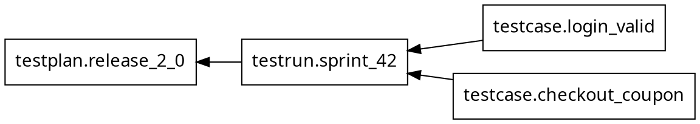
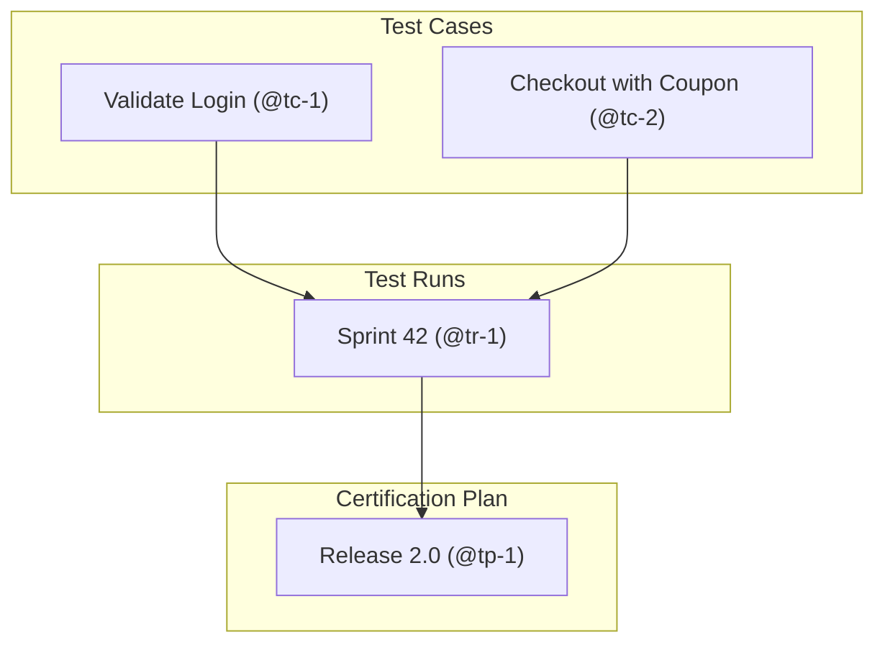
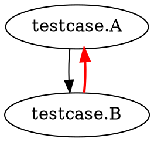

```bash
testform [global options] graph [options]
```

The `testform graph` command outputs the visual execution graph of your test infrastructure. It supports multiple output formats including the canonical Graphviz **DOT** format, native **Mermaid** diagrams, and an interactive terminal tree (**Console / Tree**).

---

## Available Options

| Option | Description |
| :--- | :--- |
| `-format=FORMAT` | Output format for the graph. Allowed values: `dot` (default), `mermaid`, `console`, `tree`, `string`. |
| `-draw-cycles` | Highlight dependency cycles in red edges for troubleshooting. |
| `-type=TYPE` | Type of operation graph to output: `plan`, `plan-refresh-only`, `plan-destroy`, or `apply`. |
| `-plan=tfplan` | Render graph using a previously saved plan file. Implies `-type=apply`. |
| `-scope=SCOPE` | Filter graph by resource scope (`testcase`, `testrun`, `testplan`). |

---

## Output Formats

### 1. DOT Format (Default Graphviz)

Ideal for generating SVG or PNG images with Graphviz tools:

```bash
$ testform graph -format=dot
```



```bash
# Export directly to SVG:
testform graph | dot -Tsvg -o dependencies.svg
```

### 2. Mermaid Format (`-format=mermaid`)

Ideal for embedding into Markdown documentation, Pull Requests, or wikis:

```bash
$ testform graph -format=mermaid
```



### 3. Console / Tree Format (`-format=console` or `-format=tree`)

Inspect dependencies directly in your terminal with a clean ASCII tree:

```bash
$ testform graph -format=console

testplan: Release v2.0 (@tp-1)
└── testrun: Sprint 42 (@tr-1)
    ├── testcase: Validate Login (@tc-1)
    └── testcase: Checkout with Coupon (@tc-2)
```

---

## Dependency Cycle Detection (`-draw-cycles`)

When circular dependencies exist between tests, the `-draw-cycles` flag detects the cycle using a depth-first search (DFS) algorithm and highlights the back-edges in red:

```bash
$ testform graph -draw-cycles -format=dot
```


