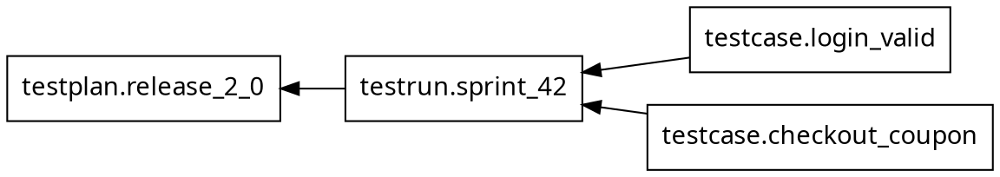
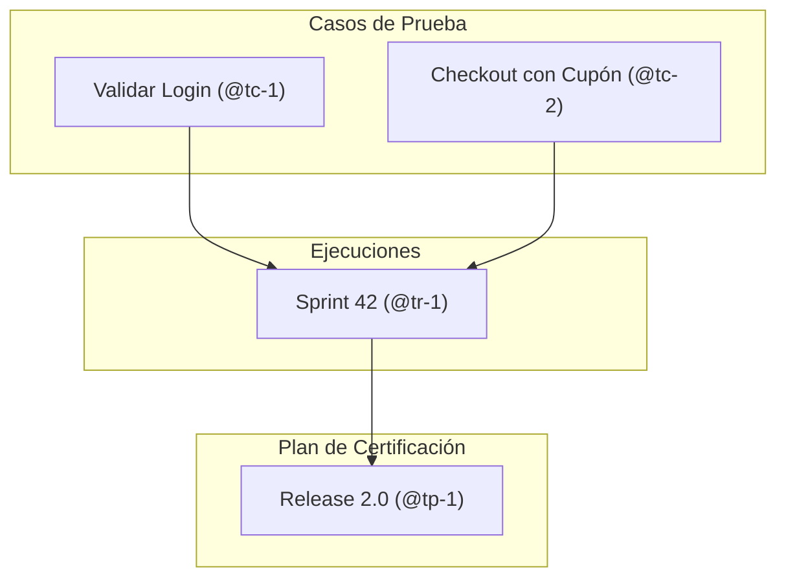
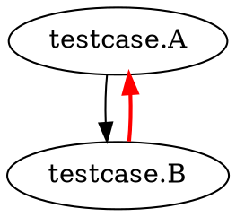

```bash
testform [opciones globales] graph [opciones]
```

El comando `testform graph` genera una representación visual del grafo de dependencias de toda tu infraestructura de pruebas. Soporta múltiples formatos de salida, incluyendo el estándar **DOT** (Graphviz), diagramas nativos de **Mermaid** y una vista en árbol para la terminal (**Console / Tree**).

---

## Opciones Disponibles

| Opción | Descripción |
| :--- | :--- |
| `-format=FORMAT` | Formato de salida del grafo. Valores admitidos: `dot` (por defecto), `mermaid`, `console`, `tree`, `string`. |
| `-draw-cycles` | Resalta cualquier ciclo de dependencia detectado con aristas rojas para diagnóstico. |
| `-type=TYPE` | Tipo de operación a graficar: `plan`, `plan-refresh-only`, `plan-destroy` o `apply`. |
| `-plan=tfplan` | Renderiza el grafo a partir de un archivo de plan previamente guardado. Implica `-type=apply`. |
| `-scope=SCOPE` | Filtra el grafo por ámbito (`testcase`, `testrun`, `testplan`). |

---

## Formatos de Salida

### 1. Formato DOT (Graphviz por defecto)

Ideal para renderizar en imágenes SVG/PNG con herramientas como Graphviz:

```bash
$ testform graph -format=dot
```



```bash
# Exportar directamente a SVG:
testform graph | dot -Tsvg -o dependencies.svg
```

### 2. Formato Mermaid (`-format=mermaid`)

Ideal para incrustar diagramas en documentación técnica, Pull Requests o archivos Markdown:

```bash
$ testform graph -format=mermaid
```



### 3. Formato Consola / Árbol (`-format=console` o `-format=tree`)

Muestra la jerarquía de dependencias en un árbol ASCII legible directamente en tu terminal:

```bash
$ testform graph -format=console

testplan: Release v2.0 (@tp-1)
└── testrun: Sprint 42 (@tr-1)
    ├── testcase: Validar Login (@tc-1)
    └── testcase: Checkout con Cupón (@tc-2)
```

---

## Detección de Dependencias Cíclicas (`-draw-cycles`)

Si dos o más pruebas tienen dependencias circulares (por ejemplo, el escenario A depende de B y B depende de A), el flag `-draw-cycles` utiliza un algoritmo de búsqueda en profundidad (DFS) para resaltar las aristas que causan el ciclo en color rojo:

```bash
$ testform graph -draw-cycles -format=dot
```



---

## Códigos de Salida

- `0`: Grafo generado exitosamente.
- `1`: Error al procesar los archivos de pruebas o sintaxis inválida.
